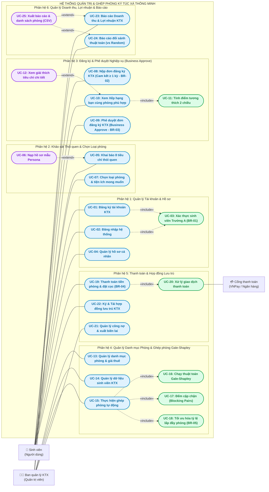

# TÀI LIỆU ĐẶC TẢ BIỂU ĐỒ USE CASE – HỆ THỐNG GHÉP PHÒNG KÝ TÚC XÁ THÔNG MINH
**Dự án:** Hệ thống Quản trị & Ghép bạn cùng phòng Ký túc xá theo Độ tương thích và Tối ưu hóa Doanh thu (KTX Smart Match & Management)  
**Nhóm thực hiện:** Nhóm 3 – Đồ án System Engineering & Kỹ thuật Hệ thống  
**Phiên bản:** 3.0 (Cập nhật toàn diện theo phản hồi: Bổ sung Quản lý Phòng, Loại phòng, Phê duyệt Business Approve, Quy trình Thanh toán, Tối ưu hóa Lợi nhuận và Quy định Nghiệp vụ KTX)

---

## 1. TỔNG QUAN HỆ THỐNG VÀ BỐI CẢNH NGIỆP VỤ

Trong thực tế vận hành ký túc xá đại học, bài toán không đơn thuần là một thuật toán ghép cặp thuần túy trong phòng thí nghiệm, mà là một **Hệ sinh thái Quản trị Ký túc xá hoàn chỉnh** kết hợp hài hòa giữa:
1. **Trải nghiệm sinh viên:** Khảo sát nếp sinh hoạt 8 tiêu chí, chọn loại phòng mong muốn phù hợp ngân sách, minh bạch hóa điểm tương thích và lý do ghép bạn cùng phòng.
2. **Nghiệp vụ Phê duyệt (Business Approve):** Ban quản lý KTX thẩm định tư cách sinh viên, kiểm tra điều kiện liên kết trường học, lịch sử kỷ luật và cam kết thời gian ở tối thiểu.
3. **Quy trình Thanh toán & Đặt cọc (Payment & Deposit):** Xử lý giao dịch thu tiền phòng theo kỳ, tiền đặt cọc cơ sở vật chất, sinh biên lai điện tử và hợp đồng lưu trú.
4. **Hiệu quả Kinh doanh & Lợi nhuận KTX (Revenue & Profit Optimization):** Quản lý danh mục phòng đa dạng (2, 4, 6 người), tối ưu hóa tỷ lệ lấp đầy giường (Occupancy Rate $\ge 90\%$), giảm thiểu chi phí vận hành phòng trống và báo cáo biên lợi nhuận ròng.

---

## 2. CÁC QUY ĐỊNH NGHIỆP VỤ CỐT LÕI (BUSINESS RULES - BR)

Hệ thống được vận hành chặt chẽ dựa trên 5 Quy tắc nghiệp vụ (Business Rules):

* **BR-01 (Quy tắc Đối tượng Tiếp nhận - Đại học Liên kết):**
  - Ký túc xá A được chỉ định phục vụ cho sinh viên thuộc **Trường Đại học A** (hoặc các đơn vị trong khối liên kết).
  - Sinh viên trường A khi đăng ký đến KTX A sẽ được hệ thống tự động xác thực qua Mã số sinh viên (MSSV) và email giáo dục (`@edu.vn`), sau đó được kích hoạt quy trình hỗ trợ tự động ghép phòng bằng thuật toán.
* **BR-02 (Quy tắc Thời hạn Hợp đồng Tối thiểu 1 Kỳ):**
  - Để đảm bảo ổn định an ninh trật tự, nếp sống văn hóa nội trú và đảm bảo dòng tiền kế hoạch tài chính của KTX, sinh viên bắt buộc phải cam kết thời gian lưu trú **tối thiểu 01 học kỳ (5 tháng)** hoặc 1 năm học.
  - Hệ thống từ chối các yêu cầu thuê phòng ngắn hạn (theo ngày/tuần) đối với diện ghép phòng tự động.
* **BR-03 (Quy trình Phê duyệt Nghiệp vụ - Business Approval Workflow):**
  - Hồ sơ đăng ký của sinh viên phải trải qua bước **Phê duyệt nghiệp vụ (Business Approve)** của BQL KTX trước khi được đưa vào hàng đợi chạy thuật toán phân phòng.
  - BQL có quyền xét duyệt diện ưu tiên chính sách, thẩm định hồ sơ và từ chối nếu sinh viên có tiền sử vi phạm nội quy KTX.
* **BR-04 (Quy tắc Đặt cọc & Thời hạn Thanh toán):**
  - Trong vòng **72 giờ** kể từ khi nhận được thông báo kết quả ghép phòng, sinh viên phải hoàn tất thanh toán tiền phòng học kỳ đầu tiên kèm **Tiền đặt cọc tài sản** (1.000.000 VNĐ).
  - Nếu quá hạn 72h chưa thanh toán, hệ thống tự động hủy kết quả giữ chỗ và chuyển nhượng vị trí cho sinh viên trong danh sách chờ (Waitlist). Nếu sinh viên đơn phương hủy hợp đồng trước hạn 1 kỳ, tiền cọc sẽ không được hoàn trả để bù đắp chi phí vận hành phòng.
* **BR-05 (Quy tắc Tối ưu hóa Lợi nhuận & Tỷ lệ Lấp đầy Phòng - Occupancy):**
  - Thuật toán ghép phòng kết hợp: Phân nhóm sinh viên theo cùng nguyện vọng loại phòng (2 người, 4 người, 6 người) trước, sau đó áp dụng Gale-Shapley để ghép cặp tương thích thói quen.
  - Ưu tiên lấp đầy 100% số giường của từng phòng trước khi mở phòng mới, tránh tình trạng nhiều phòng dở dang (ví dụ phòng 4 người chỉ có 1 người ở) gây lãng phí chi phí điện nước chung và nhân lực vệ sinh, qua đó tối đa hóa lợi nhuận ròng cho KTX.

---

## 3. TÁC NHÂN HỆ THỐNG (SYSTEM ACTORS)

1. 🧑 **Sinh viên nội trú (Student - Primary Actor):**
   - Sinh viên trường A có nhu cầu đăng ký ở ký túc xá A.
   - Khai báo hồ sơ cá nhân, chọn loại phòng & ngân sách mong muốn, làm khảo sát 8 tiêu chí thói quen, xem bảng xếp hạng gợi ý bạn cùng phòng, nộp đơn cam kết $\ge 1$ kỳ, thực hiện thanh toán tiền phòng/cọc và nhận hợp đồng.
2. 👨‍💼 **Ban quản lý KTX (Dormitory Admin / Staff - Business Actor):**
   - Cán bộ quản lý KTX chịu trách nhiệm vận hành: Quản lý danh mục phòng & đơn giá, phê duyệt nghiệp vụ hồ sơ đăng ký (Business Approve), kích hoạt thuật toán ghép phòng Gale-Shapley, quản lý công nợ thanh toán, giám sát báo cáo doanh thu & tỷ lệ lấp đầy lợi nhuận KTX.
3. 💳 **Cổng thanh toán điện tử (Payment Gateway - Secondary System Actor):**
   - Hệ thống ngân hàng / Cổng trung gian (VNPay, MoMo, Thẻ ngân hàng) tiếp nhận yêu cầu thanh toán, xử lý giao dịch an toàn và phản hồi trạng thái giao dịch cho KTX.

---

## 4. BIỂU ĐỒ USE CASE UML TOÀN DIỆN (MERMAID)

---

## 5. BẢNG DANH MỤC 25 USE CASE VÀ PHÂN VAI TRÁCH NHIỆM

| Mã UC | Tên Use Case | Tác nhân chính | Loại quan hệ | Phụ thuộc / Ghi chú | Quy định liên quan |
| :---: | :--- | :---: | :---: | :--- | :--- |
| **UC-01** | Đăng ký tài khoản KTX | Sinh viên | Core | $\rightarrow$ `<<include>>` UC-03 | BR-01 (SV trường A) |
| **UC-02** | Đăng nhập hệ thống | Sinh viên, BQL | Core | $\rightarrow$ `<<include>>` UC-03 | Bảo mật tài khoản |
| **UC-03** | Xác thực sinh viên Trường A | Hệ thống | Include | Được include bởi UC-01, UC-02 | **BR-01** |
| **UC-04** | Quản lý hồ sơ cá nhân | Sinh viên | Core | Xem/sửa thông tin liên hệ | Cập nhật hồ sơ |
| **UC-05** | Khai báo 8 tiêu chí thói quen | Sinh viên | Core | $\leftarrow$ `<<extend>>` UC-06 | 8 tiêu chí + `top` |
| **UC-06** | Nạp hồ sơ mẫu Persona | Sinh viên | Extend | Extend vào UC-05 | Thái Bảo, Văn Việt, Minh Quân |
| **UC-07** | **Chọn loại phòng & tiện ích** | Sinh viên | Core | Chọn phòng 2, 4, 6 người, AC | **Theo ý thầy: chọn loại phòng** |
| **UC-08** | **Nộp đơn đăng ký KTX** | Sinh viên | Core | Cam kết thời hạn $\ge 1$ kỳ | **BR-02 (Tối thiểu 1 kỳ)** |
| **UC-09** | **Phê duyệt đơn KTX (Business Approve)** | Ban quản lý KTX | Core | Duyệt hồ sơ, điều kiện trường A | **Theo ý thầy: Business Approve** |
| **UC-10** | Xem Xếp hạng bạn cùng phòng | Sinh viên | Core | $\rightarrow$ `<<include>>` UC-11 | Hiển thị Top 8 ứng viên |
| **UC-11** | Tính điểm tương thích 2 chiều | Hệ thống | Include | Được include bởi UC-10 | Công thức `pair_score` |
| **UC-12** | Xem giải thích tiêu chí chi tiết | Sinh viên | Extend | Extend vào UC-10 | Tiêu chí $\ge 0.8$ & $\le 0.4$ |
| **UC-13** | **Quản lý danh mục phòng & giá** | Ban quản lý KTX | Core | Cấu hình phòng 2/4/6, giá thuê | **Theo ý thầy: Quản lý phòng** |
| **UC-14** | Quản lý dữ liệu sinh viên KTX | Ban quản lý KTX | Core | Nạp file CSV, sinh dữ liệu giả lập | NFR-04 xử lý lỗi dữ liệu |
| **UC-15** | **Thực hiện ghép phòng tự động** | Ban quản lý KTX | Core | $\rightarrow$ `<<include>>` UC-16, 17, 18 | Ghép ổn định + lấp đầy phòng |
| **UC-16** | Chạy thuật toán Gale-Shapley | Hệ thống | Include | Được include bởi UC-15 | Deferred Acceptance |
| **UC-17** | Đếm cặp chặn (Blocking Pairs) | Hệ thống | Include | Được include bởi UC-15 | NFR-02: Blocking Pairs = 0 |
| **UC-18** | **Tối ưu hóa tỷ lệ lấp đầy phòng** | Hệ thống | Include | Được include bởi UC-15 | **BR-05 (Tối ưu lợi nhuận)** |
| **UC-19** | **Thanh toán tiền phòng & đặt cọc** | Sinh viên | Core | $\rightarrow$ `<<include>>` UC-20 | **Theo ý thầy: Quá trình thanh toán** |
| **UC-20** | Xử lý giao dịch thanh toán | Cổng thanh toán | Include | Kết nối VNPay / Ngân hàng | **BR-04 (Hạn 72h, cọc 1tr)** |
| **UC-21** | Quản lý công nợ & xuất biên lai | Ban quản lý KTX | Core | Đối soát giao dịch, xuất hóa đơn | Kế toán KTX |
| **UC-22** | Ký & Tải hợp đồng lưu trú KTX | Sinh viên | Core | Hợp đồng có mã QR xác thực | Chốt phòng chính thức |
| **UC-23** | **Báo cáo Doanh thu & Lợi nhuận KTX** | Ban quản lý KTX | Core | Thống kê doanh thu, chi phí, lãi ròng | **Theo ý thầy: Tính tới lợi nhuận** |
| **UC-24** | Báo cáo đối sánh thuật toán | Ban quản lý KTX | Core | So sánh Gale-Shapley vs Random | $N \in \{20, 50, 100, 200\}$ |
| **UC-25** | Xuất báo cáo & danh sách CSV | Ban quản lý KTX | Extend | Extend vào UC-23, UC-24 | Xuất file CSV phân phòng |

---

## 6. ĐẶC TẢ CHI TIẾT CÁC USE CASE BỔ SUNG MỚI (THEO YÊU CẦU CỦA THẦY)

### 6.1 Đặc tả UC-07: Chọn loại phòng & Tiện ích mong muốn
* **Tác nhân chính:** Sinh viên.
* **Mục đích:** Cho phép sinh viên lựa chọn loại không gian phòng và tiện ích phù hợp với nhu cầu sinh hoạt và khả năng tài chính.
* **Tiền điều kiện:** Sinh viên đã đăng nhập và được xác thực là sinh viên trường A.
* **Luồng sự kiện chính:**
  1. Sinh viên vào màn hình Đăng ký phòng KTX.
  2. Hệ thống tải danh sách các loại phòng đang mở từ danh mục của KTX:
     - **Phòng 2 người (Phòng Đôi Cao cấp):** Máy lạnh, tủ lạnh, bàn học riêng, WC khép kín (2.500.000 VNĐ/tháng/SV).
     - **Phòng 4 người (Phòng Tiêu chuẩn):** Máy lạnh, quạt trần, giường tầng cao cấp, WC khép kín (1.400.000 VNĐ/tháng/SV).
     - **Phòng 6 người (Phòng Tiết kiệm):** Quạt trần, tủ cá nhân, WC chung dãy (800.000 VNĐ/tháng/SV).
  3. Sinh viên chọn loại phòng mong muốn ưu tiên số 1 và số 2.
  4. Sinh viên chọn các tiện ích bổ sung nếu cần: Đăng ký vé xe tháng, dịch vụ giặt sấy.
  5. Hệ thống lưu nguyện vọng loại phòng làm tiêu chí lọc đầu vào cho thuật toán ghép cặp.

---

### 6.2 Đặc tả UC-08 & UC-09: Nộp đơn & Phê duyệt Nghiệp vụ (Business Approve)
* **Tác nhân:** Sinh viên (UC-08) và Ban Quản lý KTX (UC-09).
* **Mục đích:** Thiết lập quy trình phê duyệt chặt chẽ, đảm bảo đúng đối tượng sinh viên trường A và cam kết thời gian ở tối thiểu 1 kỳ.
* **Tiền điều kiện:** Sinh viên đã hoàn tất khảo sát thói quen và chọn loại phòng.
* **Luồng sự kiện chính (UC-08: Nộp đơn):**
  1. Sinh viên tích chọn cam kết: *"Tôi đồng ý với Quy chế Ký túc xá và cam kết thời hạn lưu trú tối thiểu 01 học kỳ (5 tháng)"* (BR-02).
  2. Sinh viên nhấn nút *"Nộp hồ sơ xét duyệt KTX"*. Trạng thái hồ sơ chuyển sang `Chờ duyệt (Pending)`.
* **Luồng sự kiện chính (UC-09: Business Approve):**
  1. Cán bộ BQL mở màn hình Quản lý Hồ sơ Đăng ký.
  2. BQL kiểm tra danh sách: Hệ thống tự động đánh dấu xanh sinh viên hợp lệ (đúng trường A, mã sinh viên còn hiệu lực, không có vi phạm kỷ luật).
  3. BQL kiểm tra tỷ lệ phân bổ nam/nữ và số lượng phòng khả dụng.
  4. BQL nhấn *"Phê duyệt (Business Approve)"* cho các hồ sơ đạt chuẩn (chuyển sang `Đã duyệt (Approved)`).
  5. Đối với hồ sơ không đạt (sai trường, vi phạm nội quy cũ), BQL nhấn *"Từ chối"* kèm lý do.
  6. Hệ thống gửi thông báo kết quả phê duyệt cho sinh viên qua ứng dụng/email.

---

### 6.3 Đặc tả UC-19, UC-20 & UC-21: Quy trình Thanh toán Tiền phòng & Đặt cọc
* **Tác nhân:** Sinh viên, Cổng thanh toán (VNPay / Ngân hàng), Ban Quản lý KTX.
* **Mục đích:** Thu tiền phòng kỳ đầu và tiền cọc tài sản trong vòng 72 giờ để hoàn tất thủ tục giữ chỗ (BR-04).
* **Tiền điều kiện:** Sinh viên đã có kết quả phân phòng chính thức từ thuật toán Gale-Shapley.
* **Luồng sự kiện chính:**
  1. Sinh viên mở màn hình Chi tiết Phân phòng & Thanh toán.
  2. Hệ thống hiển thị bảng kê chi phí kỳ 1:
     - Tiền phòng Học kỳ 1 (5 tháng): ví dụ $5 \times 1.400.000 = 7.000.000$ VNĐ.
     - Tiền đặt cọc bảo đảm tài sản KTX: $1.000.000$ VNĐ.
     - **Tổng cộng cần thanh toán:** $8.000.000$ VNĐ.
     - **Thời hạn thanh toán:** Đồng hồ đếm ngược 72 giờ.
  3. Sinh viên chọn phương thức thanh toán: *Cổng thanh toán VNPay (QR Code)* hoặc *Thẻ ATM nội địa / Thẻ quốc tế*.
  4. Hệ thống chuyển hướng sang giao diện an toàn của Cổng thanh toán (UC-20).
  5. Sinh viên quét mã QR thanh toán trên ứng dụng Mobile Banking.
  6. Cổng thanh toán xử lý giao dịch, trừ tiền tài khoản và phản hồi mã kết quả giao dịch `SUCCESS` về máy chủ KTX.
  7. Hệ thống cập nhật trạng thái hợp đồng thành `Đã thanh toán (Paid)` và cấp mã phòng chính thức.
  8. Hệ thống tự động phát hành **Biên lai điện tử có mã số thuế** và mở khóa Use Case `UC-22` cho sinh viên ký hợp đồng số.
* **Luồng ngoại lệ (Quá hạn 72h):**
  - Nếu sau 72 giờ sinh viên không thanh toán, hệ thống tự động hủy kết quả giữ phòng, hoàn trả giường về kho phòng trống để thuật toán phân phối cho sinh viên trong danh sách chờ.

---

### 6.4 Đặc tả UC-23: Quản lý Doanh thu, Lợi nhuận & Tỷ lệ Lấp đầy KTX
* **Tác nhân chính:** Ban quản lý KTX / Ban Giám đốc KTX.
* **Mục đích:** Cung cấp bức tranh tài chính toàn diện, tối ưu hóa bài toán kinh doanh và lợi nhuận cho KTX (BR-05).
* **Tiền điều kiện:** Đã hoàn thành đợt phân phòng và thu tiền sinh viên.
* **Luồng sự kiện chính:**
  1. BQL truy cập Dashboard Quản lý Doanh thu & Lợi nhuận.
  2. Hệ thống hiển thị các chỉ số tài chính chủ chốt (KPIs):
     - **Tổng doanh thu học kỳ:** $\sum (\text{Giá phòng} \times \text{Số SV đã đóng})$.
     - **Tổng tiền cọc đang quản lý:** $1.000.000 \times \text{Tổng số sinh viên nội trú}$.
     - **Chi phí vận hành ước tính:** Tiền điện nước định mức, chi phí bảo vệ, vệ sinh, bảo trì định kỳ.
     - **Lợi nhuận ròng dự kiến:** $\text{Doanh thu} - \text{Chi phí vận hành}$.
     - **Tỷ lệ lấp đầy giường (Occupancy Rate):** $\frac{\text{Số giường đã ở}}{\text{Tổng số giường khả dụng}} \times 100\%$.
  3. Biểu đồ phân tích cấu trúc doanh thu theo từng phân khúc loại phòng:
     - Tỷ trọng phòng 2 người (biên lợi nhuận cao nhất).
     - Tỷ trọng phòng 4 người (chiếm tỷ trọng số lượng lớn nhất).
     - Tỷ trọng phòng 6 người (đáp ứng diện an sinh sinh viên).
  4. Cảnh báo các phòng bị trống giường dở dang để BQL kích hoạt chính sách dồn phòng hoặc ghép bổ sung đợt 2 nhằm triệt tiêu lãng phí vận hành.
  5. BQL có thể xuất báo cáo tài chính ra file Excel/CSV (UC-25).

---

## 7. ĐỐI CHIẾU VỚI Ý KIẾN GÓP Ý CỦA THẦY GIÁO

| Điểm thầy giáo góp ý trong ảnh | Đã khắc phục & bổ sung trong Sơ đồ Use Case v3.0 | Mã Use Case / Business Rules tương ứng |
| :--- | :--- | :--- |
| **"Chưa tính tới lợi nhuận"** | Bổ sung phân hệ Quản lý Tài chính, tính toán doanh thu từng loại phòng, chi phí vận hành, lợi nhuận ròng và tối ưu tỷ lệ lấp đầy phòng trống. | **UC-23, UC-25, BR-05** |
| **"Thiếu business approve"** | Thiết lập quy trình phê duyệt nghiệp vụ bắt buộc: BQL kiểm tra tính hợp lệ của sinh viên trường A trước khi chạy giải thuật ghép phòng. | **UC-09, BR-03** |
| **"Chưa có quản lý phòng, muốn ở loại phòng nào"** | Thêm Use Case Quản lý danh mục phòng cho BQL và Use Case Chọn loại phòng (2/4/6 giường, máy lạnh) cho sinh viên trước khi ghép cặp. | **UC-07, UC-13** |
| **"Chưa tính tới quá trình thanh toán"** | Bổ sung quy trình thanh toán tiền phòng kỳ 1 + tiền cọc 72h, tích hợp cổng thanh toán trực tuyến, xuất biên lai điện tử và ký hợp đồng. | **UC-19, UC-20, UC-21, UC-22, BR-04** |
| **"Business rules: sv A tới ktx A tự động ghép, ở tối thiểu 1 kỳ"** | Đưa trực tiếp vào 2 quy tắc nền tảng: BR-01 (Xác thực SV trường A) và BR-02 (Cam kết hợp đồng lưu trú tối thiểu 1 học kỳ). | **BR-01, BR-02, UC-03, UC-08** |
