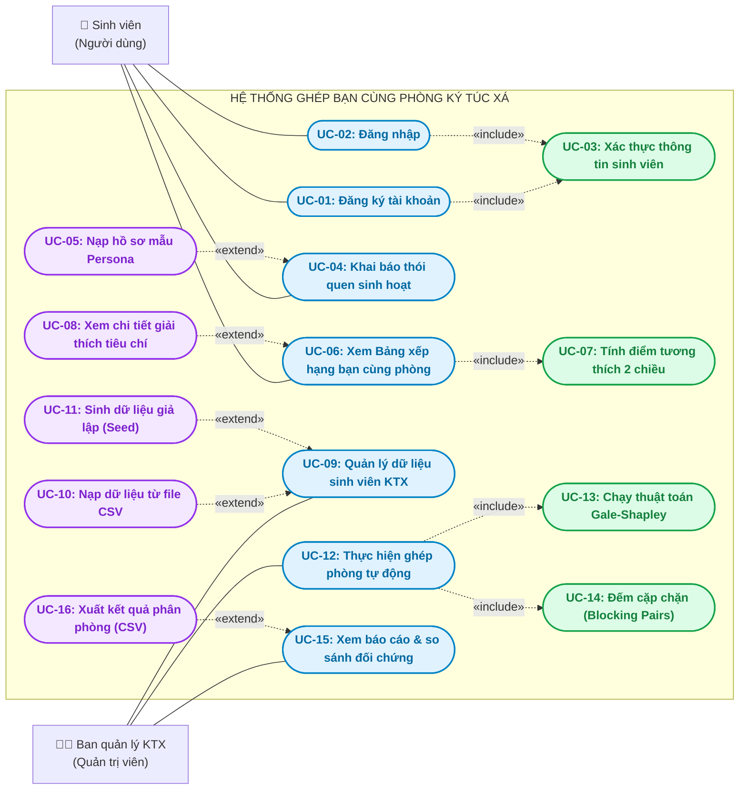

# TÀI LIỆU BIỂU ĐỒ USE CASE – HỆ THỐNG GHÉP BẠN CÙNG PHÒNG KÝ TÚC XÁ
**Dự án:** Hệ thống xếp phòng ký túc xá thông minh theo độ tương thích thói quen (KTX Smart Roommate Matching)  
**Nhóm thực hiện:** Nhóm 3 – Đồ án Trí tuệ Nhân tạo & Thuật toán Ghép cặp ổn định Gale-Shapley (2026)  
**Phiên bản:** 2.0 (Cập nhật chuẩn UML theo mẫu phân tích chức năng)

---

## 1. TỔNG QUAN BIỂU ĐỒ USE CASE
Hệ thống giải quyết bài toán mâu thuẫn sinh hoạt nội trú KTX bằng cách thu thập khảo sát 8 tiêu chí thói quen sống và áp dụng thuật toán đề xuất và chấp nhận hoãn lại (**Gale-Shapley Algorithm**) để xếp phòng với tiêu chí **0 cặp chặn (Blocking Pairs = 0)**.

Biểu đồ Use Case phân định rõ ràng 02 tác nhân (Actor) chính:
1. **Sinh viên nội trú (Người dùng cuối):** Tương tác với cổng thông tin sinh viên để khai báo thói quen và nhận bảng xếp hạng bạn cùng phòng phù hợp từ Hạng 1 đến Hạng 8.
2. **Ban quản lý KTX (Quản trị viên):** Quản trị danh sách dữ liệu sinh viên, kích hoạt thuật toán ghép phòng tự động trên quy mô lớn và xem báo cáo đối sánh thực nghiệm.

---

## 2. BIỂU ĐỒ USE CASE UML (MERMAID)

---

## 3. NGUYÊN TẮC QUAN HỆ TRONG BIỂU ĐỒ (THEO CHUẨN UML)

### 3.1 Quan hệ `<<include>>` (Bắt buộc dùng chung)
* **Khái niệm:** Use case gốc luôn bắt buộc phải thực hiện hành vi của Use case được include như một phần cốt lõi của quy trình xử lý.
* **Quy tắc mũi tên:** Mũi tên nét đứt hướng **về phía** Use case được include (`A ..>|<<include>>| B`).
* **Áp dụng trong hệ thống:**
  1. `UC-01 (Đăng ký)` & `UC-02 (Đăng nhập)` $\rightarrow$ `<<include>>` $\rightarrow$ `UC-03 (Xác thực thông tin sinh viên)`: Mọi hành động đăng ký hoặc đăng nhập đều phải kiểm tra mã sinh viên và mật khẩu hợp lệ trước khi cấp phiên làm việc.
  2. `UC-06 (Xem Bảng xếp hạng bạn cùng phòng)` $\rightarrow$ `<<include>>` $\rightarrow$ `UC-07 (Tính điểm tương thích 2 chiều)`: Để hiển thị bảng xếp hạng từ Hạng 1 đến Hạng 8, hệ thống bắt buộc phải tính ma trận điểm 2 chiều $M[a][b]$ và $M[b][a]$ dựa trên 8 tiêu chí.
  3. `UC-12 (Thực hiện ghép phòng tự động)` $\rightarrow$ `<<include>>` $\rightarrow$ `UC-13 (Chạy thuật toán Gale-Shapley)` & `UC-14 (Đếm cặp chặn)`: Quy trình ghép phòng bắt buộc phải chạy thuật toán Gale-Shapley và tự động quét kiểm tra blocking pairs để chứng minh tính ổn định tuyệt đối.

### 3.2 Quan hệ `<<extend>>` (Mở rộng tùy điều kiện)
* **Khái niệm:** Use case mở rộng bổ sung hành vi cho Use case gốc khi và chỉ khi thỏa mãn một điều kiện nghiệp vụ nhất định (extension point). Use case gốc vẫn hoạt động độc lập và hoàn chỉnh nếu không có hành vi mở rộng này.
* **Quy tắc mũi tên:** Mũi tên nét đứt hướng **ngược về phía** Use case gốc (`B ..>|<<extend>>| A`).
* **Áp dụng trong hệ thống:**
  1. `UC-05 (Nạp hồ sơ mẫu Persona)` $\rightarrow$ `<<extend>>` $\rightarrow$ `UC-04 (Khai báo thói quen sinh hoạt)`: Chỉ xảy ra khi sinh viên muốn thử nghiệm nhanh bằng cách nhấp chọn các hồ sơ mẫu điển hình (Nguyễn Duy Thái Bảo - VNUK, Lê Văn Việt - SPKT, Lê Minh Quân - DUE). Sinh viên vẫn có thể tự nhập tay thói quen của riêng mình.
  2. `UC-08 (Xem chi tiết giải thích tiêu chí)` $\rightarrow$ `<<extend>>` $\rightarrow$ `UC-06 (Xem Bảng xếp hạng bạn cùng phòng)`: Bảng xếp hạng mặc định chỉ hiển thị thẻ tóm tắt và % điểm tương thích. Hành vi phân tích sâu chỉ diễn ra khi người dùng nhấp vào nút *"Chi tiết tiêu chí ▼"* để xem danh sách điểm cộng hòa hợp ($\ge 0.75$) và điểm lưu ý ($\le 0.40$).
  3. `UC-10 (Nạp dữ liệu từ file CSV)` & `UC-11 (Sinh dữ liệu giả lập Seed)` $\rightarrow$ `<<extend>>` $\rightarrow$ `UC-09 (Quản lý dữ liệu sinh viên KTX)`: Cung cấp phương thức nạp dữ liệu hàng loạt tùy theo nhu cầu của Ban quản lý.
  4. `UC-16 (Xuất kết quả phân phòng CSV)` $\rightarrow$ `<<extend>>` $\rightarrow$ `UC-15 (Xem báo cáo & so sánh đối chứng)`: Chỉ kích hoạt khi Ban quản lý cần tải file bảng điểm chính thức để in ấn và dán thông báo tại sảnh KTX.

### 3.3 Lưu ý quan trọng: Không có `<<exclude>>` trong UML
* Chuẩn UML thế giới (OMG UML Standard) **hoàn toàn không tồn tại quan hệ `<<exclude>>`**.
* Để biểu diễn các điều kiện bài trừ hoặc ràng buộc nghiệp vụ trong dự án KTX, ta sử dụng:
  * **Constraint (Ràng buộc nghiệp vụ):** Ví dụ sinh viên khai báo tiêu chí `smoke = 0` (dị ứng khói thuốc) thì hệ thống kích hoạt ràng buộc cứng loại bỏ các ứng viên có `smoke = 1`.
  * **Precondition (Tiền điều kiện):** Sinh viên bắt buộc phải hoàn thành `UC-02 (Đăng nhập)` thì mới được phép truy cập `UC-04 (Khai báo thói quen)` và `UC-06 (Xem bảng xếp hạng)`.
  * **Business Rule (Quy tắc bài trừ):** Hai sinh viên cùng một nhóm không được phép ghép phòng với nhau (Nhóm A chỉ ghép với Nhóm B trong mô hình hai phía).

---

## 4. BẢNG DANH MỤC USE CASE VÀ ÁNH XẠ YÊU CẦU DỰ ÁN

| Mã UC | Tên Use Case | Tác nhân | Phân loại | Quan hệ | Yêu cầu nghiệp vụ / kỹ thuật ánh xạ |
| :--- | :--- | :--- | :--- | :--- | :--- |
| **UC-01** | Đăng ký tài khoản | Sinh viên | Use case chính | $\rightarrow$ `<<include>>` UC-03 | FR-01, SR-01 |
| **UC-02** | Đăng nhập hệ thống | Sinh viên | Use case chính | $\rightarrow$ `<<include>>` UC-03 | FR-01, SR-01 |
| **UC-03** | Xác thực thông tin sinh viên | Hệ thống | Include | Được include bởi UC-01, UC-02 | SR-01, BR-04 |
| **UC-04** | Khai báo thói quen sinh hoạt | Sinh viên | Use case chính | $\leftarrow$ `<<extend>>` UC-05 | FR-01, SR-01, BR-01 |
| **UC-05** | Nạp hồ sơ mẫu Persona | Sinh viên | Extend | Extend vào UC-04 | FR-01 |
| **UC-06** | Xem Bảng xếp hạng bạn cùng phòng | Sinh viên | Use case chính | $\rightarrow$ `<<include>>` UC-07, $\leftarrow$ `<<extend>>` UC-08 | FR-04, FR-05, SR-02, BR-01 |
| **UC-07** | Tính điểm tương thích 2 chiều | Hệ thống | Include | Được include bởi UC-06 | FR-04, BR-01 |
| **UC-08** | Xem chi tiết giải thích tiêu chí | Sinh viên | Extend | Extend vào UC-06 | FR-09, SR-03, BR-04 |
| **UC-09** | Quản lý dữ liệu sinh viên KTX | Ban quản lý KTX | Use case chính | $\leftarrow$ `<<extend>>` UC-10, UC-11 | FR-02, FR-03, SR-04, BR-03 |
| **UC-10** | Nạp dữ liệu từ file CSV | Ban quản lý KTX | Extend | Extend vào UC-09 | FR-02, SR-04 |
| **UC-11** | Sinh dữ liệu giả lập (Seed) | Ban quản lý KTX | Extend | Extend vào UC-09 | FR-03, SR-04 |
| **UC-12** | Thực hiện ghép phòng tự động | Ban quản lý KTX | Use case chính | $\rightarrow$ `<<include>>` UC-13, UC-14 | FR-06, FR-08, SR-05, BR-02 |
| **UC-13** | Chạy thuật toán Gale-Shapley | Hệ thống | Include | Được include bởi UC-12 | FR-06, SR-05, BR-02 |
| **UC-14** | Đếm cặp chặn (Blocking Pairs) | Hệ thống | Include | Được include bởi UC-12 | FR-08, SR-05, BR-02 |
| **UC-15** | Xem báo cáo & so sánh đối chứng | Ban quản lý KTX | Use case chính | $\leftarrow$ `<<extend>>` UC-16 | FR-07, FR-10, SR-06, BR-01 |
| **UC-16** | Xuất kết quả phân phòng (CSV) | Ban quản lý KTX | Extend | Extend vào UC-15 | FR-11, SR-08, BR-03 |

---

## 5. ĐẶC TẢ CHI TIẾT CÁC USE CASE TRỌNG TÂM (USE CASE SPECIFICATION)

### 5.1 Đặc tả UC-04: Khai báo thói quen sinh hoạt
* **Tác nhân chính:** Sinh viên.
* **Mục đích:** Thu thập chính xác nếp sinh hoạt đời thực của sinh viên để làm đầu vào cho thuật toán xếp hạng.
* **Tiền điều kiện (Preconditions):** Sinh viên đã đăng nhập thành công vào hệ thống.
* **Hậu điều kiện (Postconditions):** Thông tin thói quen được ghi nhận và truyền sang bộ tính điểm tương thích.
* **Luồng sự kiện chính (Basic Flow):**
  1. Sinh viên mở biểu mẫu nhập thói quen trên màn hình Dashboard.
  2. Sinh viên kéo thanh trượt chọn giờ đi ngủ (`sleep`) và giờ thức dậy (`wake`).
  3. Sinh viên chọn các mức độ: gọn gàng (`tidy`), chịu tiếng ồn (`noise`), dắt bạn về phòng (`guests`).
  4. Sinh viên chọn thói quen học tập (`study`), tình trạng hút thuốc (`smoke`) và tích chọn các sở thích chung (`hobbies`).
  5. Sinh viên chỉ định tiêu chí quan trọng nhất đối với bản thân (`top`) để nhận hệ số ưu tiên 1.5x.
  6. Sinh viên nhấn nút *"Tính toán & Cập nhật Xếp hạng"*.
* **Luồng mở rộng (Extension Flow - UC-05):**
  * Tại bước 1, nếu sinh viên muốn thử nghiệm nhanh, sinh viên có thể nhấp chọn 1 trong 3 nút Persona mẫu:
    * *Thái Bảo (VNUK)*: Tự điền ngủ 22h, dậy 6h, gọn 5/5, học thư viện, ưu tiên ngủ sớm.
    * *Văn Việt (SPKT)*: Tự điền ngủ 2h sáng, dậy 9h30, gọn 2/5, học tại phòng, ưu tiên chịu tiếng ồn.
    * *Minh Quân (DUE)*: Tự điền ngủ 23h30, dậy 6h30, gọn 4/5, ưu tiên không khói thuốc.

---

### 5.2 Đặc tả UC-06: Xem Bảng xếp hạng bạn cùng phòng
* **Tác nhân chính:** Sinh viên.
* **Mục đích:** Cung cấp cho sinh viên danh sách những bạn cùng phòng tương thích nhất theo thứ tự giảm dần từ Hạng 1 đến Hạng 8.
* **Bao gồm (Include):** `UC-07 (Tính điểm tương thích 2 chiều)`.
* **Mở rộng (Extend):** `UC-08 (Xem chi tiết giải thích tiêu chí)`.
* **Luồng sự kiện chính:**
  1. Sau khi nhận được thói quen của người dùng, hệ thống tự động lọc danh sách sinh viên thuộc nhóm đối diện (Nhóm B nếu người dùng là Nhóm A, hoặc ngược lại).
  2. Hệ thống gọi Use Case `UC-07` để tính toán ma trận điểm tương thích 2 chiều:
     $$\text{AvgScore}(A, B) = \frac{\text{Score}(A \rightarrow B) + \text{Score}(B \rightarrow A)}{2}$$
  3. Hệ thống sắp xếp danh sách giảm dần và gán nhãn thứ hạng từ `#1` (Hạng 1) đến `#8` (Hạng 8).
  4. Giao diện hiển thị các thẻ ứng viên với huy hiệu xếp hạng (🥇 Hạng 1, 🥈 Hạng 2, 🥉 Hạng 3), ảnh đại diện, trường đại học, % điểm và thẻ đánh giá hòa hợp (*Siêu hòa hợp*, *Hòa hợp tốt*, *Cần thỏa hiệp*, *Dễ xung đột*).
* **Luồng mở rộng (UC-08):**
  * Sinh viên nhấp vào nút *"Chi tiết tiêu chí ▼"* trên thẻ ứng viên bất kỳ.
  * Hệ thống mở rộng hiển thị 2 khối thông tin phân tích rõ ràng:
    * ✅ **Điểm cộng tương thích:** Liệt kê các tiêu chí có điểm hòa hợp cao $\ge 0.75$.
    * ⚠️ **Điểm cần lưu ý:** Cảnh báo các tiêu chí có nguy cơ lệch pha $\le 0.40$.

---

### 5.3 Đặc tả UC-12: Thực hiện ghép phòng tự động
* **Tác nhân chính:** Ban quản lý KTX.
* **Mục đích:** Xếp phòng toàn diện cho hàng trăm sinh viên KTX đảm bảo không phát sinh mâu thuẫn đổi phòng (Cặp chặn = 0).
* **Bao gồm (Include):** `UC-13 (Chạy thuật toán Gale-Shapley)` và `UC-14 (Đếm cặp chặn)`.
* **Luồng sự kiện chính:**
  1. Ban quản lý KTX nhấn nút *"Khởi chạy ghép phòng tự động"*.
  2. Hệ thống gọi `UC-13` áp dụng thuật toán Gale-Shapley (Deferred Acceptance):
     * Các sinh viên nhóm A lần lượt đề xuất ghép phòng với ứng viên nhóm B mà mình yêu thích nhất theo danh sách ưu tiên.
     * Sinh viên nhóm B tạm thời giữ lời đề xuất tốt nhất và từ chối các lời đề xuất kém hơn.
     * Quá trình lặp lại cho đến khi toàn bộ sinh viên đều được ghép phòng.
  3. Hệ thống gọi `UC-14` để kiểm tra toàn bộ các cặp chéo.
  4. Kết quả trả về danh sách phân phòng chính thức cùng chứng chỉ số cặp chặn $\text{Blocking Pairs} = 0$.
